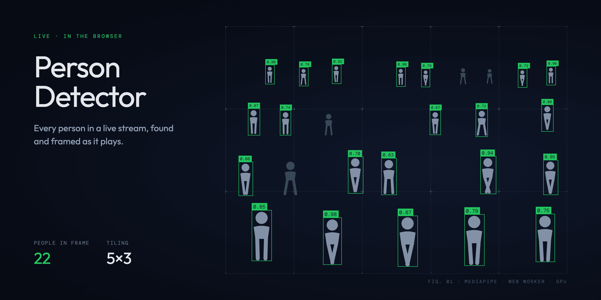
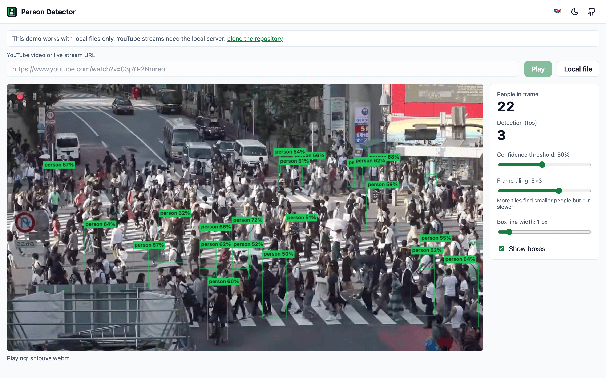

# Person Detector 🎥

Watch a YouTube video or live stream (muted) and see every detected person framed with a bounding box, live in the browser.

<picture>
  <source media="(prefers-color-scheme: dark)" srcset="docs/screenshots/detection-dark.png">
  
</picture>

_Video in the screenshot: [Shibuya Crossing, Tokyo, Japan](<https://commons.wikimedia.org/wiki/File:Shibuya_Crossing,_Tokyo,_Japan_(video).webm>) by Basile Morin, [CC BY-SA 4.0](https://creativecommons.org/licenses/by-sa/4.0/)._

## Live demo 🌐

Try it at [piecioshka.github.io/person-detector](https://piecioshka.github.io/person-detector/).

> [!NOTE] The online demo works with local video files only. YouTube videos and live streams need the local server, so [clone the repository](https://github.com/piecioshka/person-detector) and run it yourself.

## Features ✨

- 📡 Plays YouTube live streams and regular videos straight from a pasted link
- 🟩 Draws a box with a confidence score around each detected person
- 🧩 Tiled detection for wide shots where people are only a few pixels tall _(adjustable grid)_
- 🎚️ Adjustable confidence threshold and a live people counter
- 🧵 Inference runs in a Web Worker on the GPU, so the page stays responsive
- 📁 Works with local video files too
- 🔒 Everything runs locally: the model and runtime are bundled, no frames leave your machine
- 🌗 Light and dark theme, Polish and English interface, keyboard shortcuts under `?`

## Contributing 🛠️

See [CONTRIBUTING.md](CONTRIBUTING.md).

## License 📄

[The MIT License](https://piecioshka.mit-license.org) @ 2026
